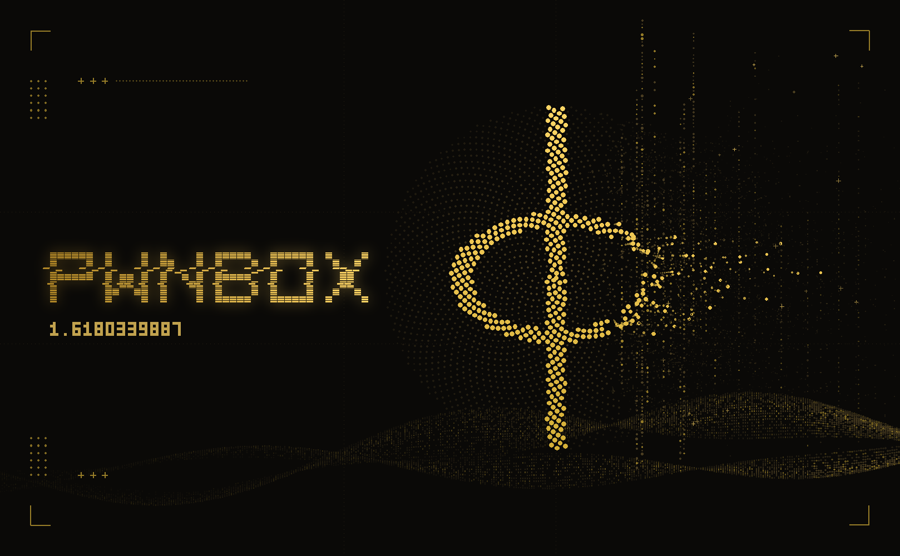

<p align="center">
  
</p>

<p align="center">
  <b>pwnbox·phi</b> &nbsp;·&nbsp; φ = 1.6180339887…
</p>

<p align="center">
  A <a href="https://nixos.org">NixOS</a> +
  <a href="https://github.com/nix-community/home-manager">home-manager</a> box for
  hacking, reverse engineering, Active Directory and networking, built on
  <a href="https://github.com/kernelstub/Pwnbox">kernelstub/Pwnbox</a>.
  Mullvad is on from the first boot, the hardening goes further, it installs
  itself from its own ISO (next to Windows if you want), and everything it
  draws is laid out on the golden ratio.
</p>

---

## What phi adds

| | |
| --- | --- |
| **Mullvad built in** | On by default. Kill switch (lockdown) once you log in, post-quantum WireGuard, DAITA, DNS blocklists for ads, trackers and malware. Re-applied every boot, so the flake is the source of truth. |
| **More hardening** | Random MAC on every connection, hostname kept out of DHCP, pings ignored, `io_uring` root-only, authenticated time (NTS). USBGuard, no-webcam and kernel lockdown when you want them. |
| **`phi-install`** | A full-screen installer on a custom ISO. LUKS2 with Argon2id, ext4 or btrfs, dual boot next to Windows without touching a Windows partition. Nothing is written until you type the disk's name. |
| **`phi-audit`** | Grades the running system against everything above. |
| **`phi-panic`** | `SUPER + SHIFT + ESC`: kill switch on, network off, clipboard wiped, screen locked. |
| **The look** | Gold on near-black. A golden rectangle and spiral drawn in braille, boot splashes, a wallpaper, and the banner up top, all generated from the same geometry. |

## Install

**From the installer ISO** (new machine, or next to Windows):

```bash
./scripts/iso.sh installer        # on any machine with nix
```

Flash `iso/pwnbox-phi-installer-<arch>.iso`, boot it, and `phi-install`
starts on its own. Walkthrough, disk layouts and the dual-boot rules:
[phi-install](docs/setup/phi-install.md).

**On an existing NixOS install:**

```bash
git clone https://github.com/convolutionary/pwnbox-phi
cd pwnbox-phi
./scripts/install.sh switch
```

It picks up your user, hostname, time zone and hardware, writes
`hosts/<host>/` and switches. Details in
[Getting started](docs/setup/getting-started.md).

After the first login:

```bash
phi-vpn login     # mullvad asks for your account number, then the kill switch arms
phi-audit         # see where the box stands
```

## The phi tools

```bash
phi               # the banner
phi spiral        # builds the golden rectangle square by square
phi-vpn           # tunnel status. up / down / hop / check (leak test) / harden
phi-audit         # hardening grade. --offline skips the network checks
phi-panic         # the panic button. phi-panic undo brings the network back
phi stamp FILE    # puts the φ header on a script
```

More in [φ phi](docs/usage/phi.md).

## What you get from pwnbox

| Area | |
| --- | --- |
| **Offensive tooling** | 26 toggleable categories, from recon and Active Directory to reversing, pwn, forensics, cloud and more. |
| **Daily-driver apps** | Encrypted chat, browsers, office, media, wallets, containers and VMs, plus Neovim, Zed and IDA Free / Pro. |
| **Theming** | One palette from a pywal wallpaper or fixed theme, applied across the desktop, terminals, editors, chat apps, browser and IDA. Pick the `phi-golden-spiral` wallpaper and all of it goes gold. |
| **Privacy** | Volatile logs, zram-only swap, RAM-backed `/tmp`, a hardened kernel and network, locked root, firewall on and a hardened Tor Browser. |
| **Desktop** | Hyprland with a Quickshell bar, notifications and control center, or GNOME as a second session. |
| **Reproducibility** | Every package, font and theme comes from the flake; nothing is downloaded at runtime. |

## Where the ratio shows up

- The rule in every script header is 55 characters with φ at column 34.
  Both are Fibonacci numbers, and 55/34 ≈ φ.
- Dividers in the tools glow brightest at `width/φ`, the golden cut.
- `phi-audit` grades on the cuts: gilded above 1/φ (61.8%), brass above
  1/φ² (38.2%).
- Boot partitions are 987 MiB, a Fibonacci number.
- In the banner, the φ is cut out of a sunflower whose seeds sit at the
  golden angle (137.5°). Every size is a power of φ, the emblem sits on the
  golden section, and the banner itself is 1618×1000, a golden rectangle.
  `phi/art/make-banner.py` checks that geometry each time it renders.

## Documentation

The full manual is in [`docs/`](docs/README.md):

| Document | What it covers |
| --- | --- |
| [phi-install](docs/setup/phi-install.md) | The installer, disk layout, encryption, dual boot with Windows |
| [φ phi](docs/usage/phi.md) | Mullvad, extra hardening, the phi tools, the mark |
| [Getting started](docs/setup/getting-started.md) | Install on existing NixOS, first boot, updates, host config |
| [ISOs](docs/setup/isos.md) | Live and installer ISOs, booting |
| [Desktop](docs/usage/desktop.md) | Hyprland, GNOME, Quickshell and the bar |
| [Keybinds](docs/usage/keybinds.md) | Every keyboard shortcut |
| [Themes](docs/usage/themes.md) | Wallpaper themes, custom and community themes, the `ALT + S` menu |
| [Fonts](docs/usage/fonts.md) | System/application fonts and sizes |
| [Apps](docs/usage/apps.md) | Per-app theming and live updates |
| [Browser](docs/usage/browser.md) | Zen, site themes and the pwnbox styles extension |
| [Packages](docs/reference/packages.md) | Tool categories and optional app sets |
| [Privacy](docs/usage/privacy.md) | Hardening and zero-trace defaults |
| [Architecture](docs/development/architecture.md) | Repo layout and how a theme switch works |
| [Troubleshooting](docs/reference/troubleshooting.md) | Common problems and fixes |
| [Development](docs/development/workflow.md) | Add themes, packages and bar styles |

## Community themes

Extra fixed-palette themes live in
[kernelstub/Pwnbox-Themes](https://github.com/kernelstub/Pwnbox-Themes). Copy a
theme folder into `dotfiles/themes/`, `git add` it, rebuild with
`./scripts/install.sh switch`, then pick it from `ALT + S → Custom`. See
[Themes](docs/usage/themes.md#community-themes).

## Community

- [Security policy](SECURITY.md): what counts as a vulnerability and how to
  report one privately
- [Contributing](CONTRIBUTING.md): repo layout, style, testing before a PR
- [Code of conduct](CODE_OF_CONDUCT.md)

Issues and pull requests are welcome. For anything in pwnbox itself rather
than the phi parts, upstream is the better place:
[kernelstub/Pwnbox](https://github.com/kernelstub/Pwnbox).

## Credits

pwnbox was created by **Prepakis Georgios** (kernelstub):
[x.com/kernelstub](https://x.com/kernelstub),
[kern@skuntir.com](mailto:kern@skuntir.com). The desktop, the toolset, the
theming system and most of this repo are their work.

The phi edition (Mullvad, hardening, the installer, the art) is maintained at
[convolutionary/pwnbox-phi](https://github.com/convolutionary/pwnbox-phi).

## License

Public domain under the [Unlicense](LICENSE), same as upstream. Do anything you
want with it.
